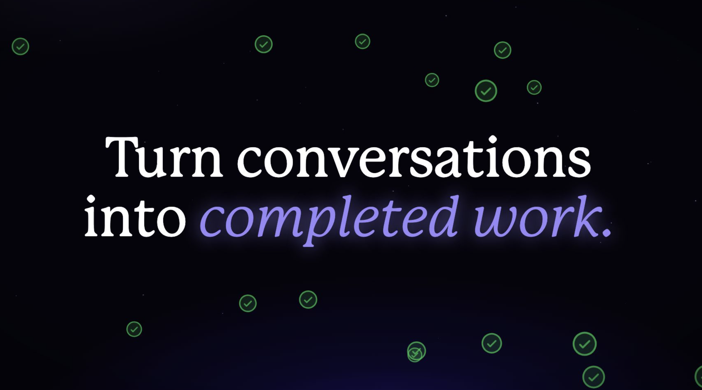
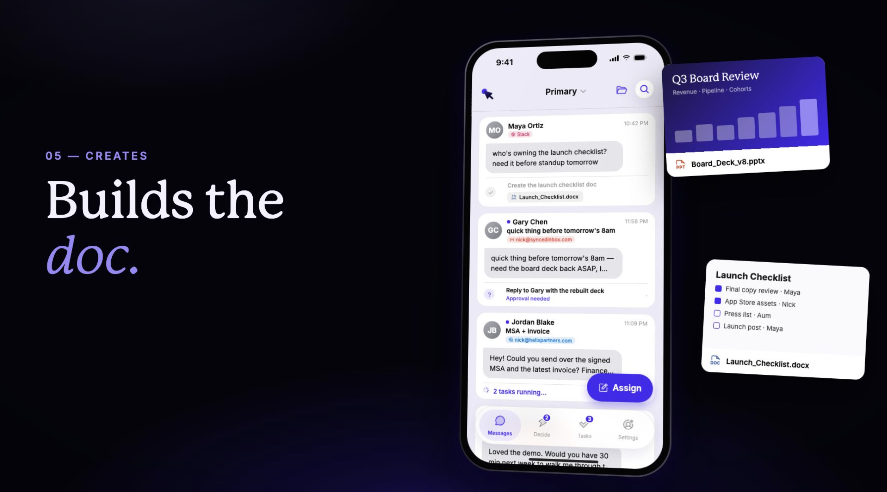
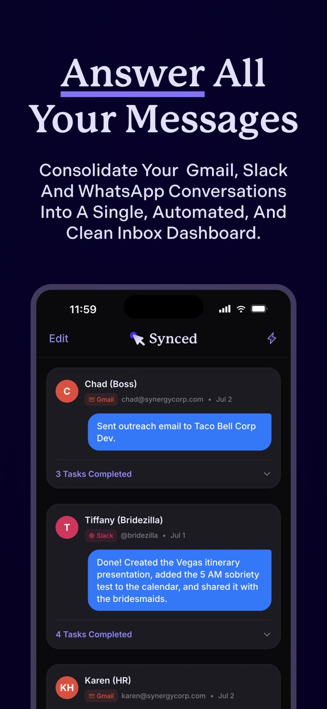
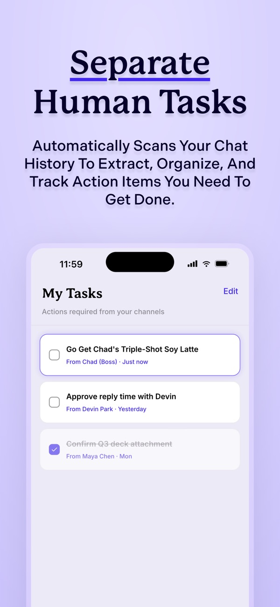
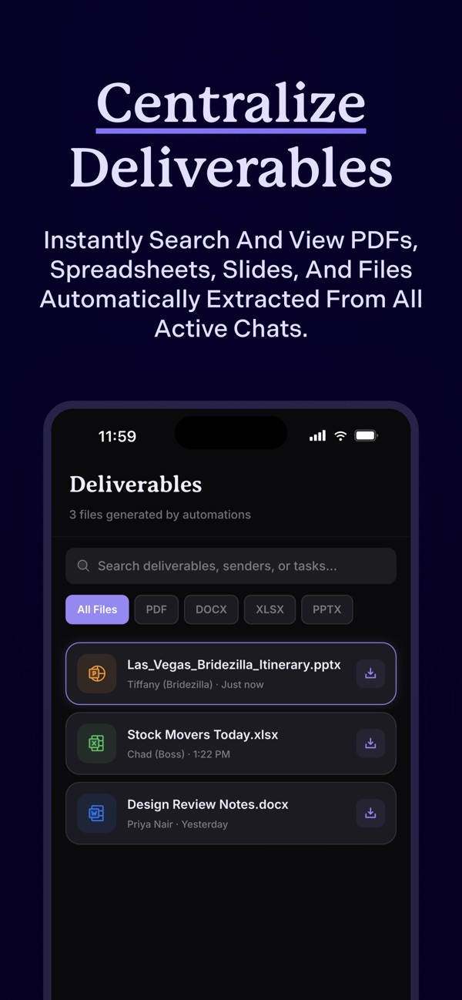

  

  

<h1 align="center">Synced</h1>

Your inbox, on autopilot.

Expo · React Native · TypeScript · Firebase · RevenueCat

Synced brings messages, action items, and completed work into one place. It helps turn incoming requests into action plans, keeps the tasks that need your attention separate, and organizes the files produced along the way.

  <a href="https://apps.apple.com/us/app/synced-inbox-on-autopilot/id6783661720">View on the App Store</a>

## From a message to a finished document

Synced keeps the request, the action plan, and the resulting file connected. Review the work in the context of the conversation and step in when approval is needed.

  

## Inside the app

<table>
  <tr>
    <td align="center"></td>
    <td align="center"></td>
    <td align="center"></td>
  </tr>
  <tr>
    <td align="center"><strong>Follow the conversation</strong></td>
    <td align="center"><strong>Know what needs you</strong></td>
    <td align="center"><strong>Find the finished work</strong></td>
  </tr>
</table>

*Product screenshots from the public App Store listing. Screens reflect the marketed app experience; this repository contains the earlier integration milestone described below.*

## How Synced works

1. **Connect your workflow.** Bring supported messaging accounts and work services into the app.
2. **Turn requests into action plans.** Follow the conversation alongside the tasks it creates.
3. **Stay involved where it matters.** Review questions and approvals, and track tasks that need your attention.
4. **Keep the output together.** Browse documents, spreadsheets, presentations, and other deliverables from your work.

The mobile interface includes onboarding, conversations, task management, approval flows, deliverables, and subscription settings, with light and dark themes.

## RevenueCat integration

This source release captures the first RevenueCat milestone: a native subscription experience connecting purchases, account identity, and weekly usage limits.

The paywall loads monthly and annual packages from RevenueCat, displays localized pricing, and supports purchases and restores. RevenueCat uses the authenticated Firebase user ID to connect subscriptions to an account. The client reads subscription status and usage from Firestore.

| Component | Source |
| --- | --- |
| SDK setup and account identity | [services/purchases.ts](services/purchases.ts) |
| Offerings, purchases, and restores | [app/paywall.tsx](app/paywall.tsx) |
| Subscription state and weekly usage | [contexts/UserContext.tsx](contexts/UserContext.tsx) |
| Plan and usage settings | [Settings screen](app/%28main%29/settings.tsx) |
| Server subscription updates | [Webhook walkthrough](docs/revenuecat-webhook.md) |

At this milestone, the Free plan included 20 Action Plans per week and Pro included 100. The server enforced these limits, while the app displayed current usage and upgrade options.

## Explore the app

- **app/** — onboarding, inbox, conversations, tasks, settings, and paywall.
- **components/** — shared interface components and approval flows.
- **contexts/** — account state, subscriptions, and usage.
- **services/** — purchases, authentication, storage, and integrations.

## Development setup

This release contains the mobile client and a reference excerpt of the RevenueCat webhook. Running the complete app requires your own Firebase backend and integration services.

1. Install dependencies with `npm ci`.
2. Copy `.env.example` to `.env` and add your development configuration.
3. Add your Firebase files at `assets/GoogleService-Info.plist` and `assets/google-services.json`. Set your app identifiers and Google OAuth scheme in `app.json`.
4. Configure your RevenueCat offerings and the `Synced - Inbox on Autopilot Pro` entitlement. Set the iOS and Android SDK keys in the corresponding environment variables.
5. Connect your backend, then use a native development build and store sandbox to exercise purchases and restores.

`EXPO_PUBLIC_*` values are included in the app bundle. Keep server credentials and model API keys in your backend. Inter supplies the font registrations in this source release.

## About this release

Based on the August 16, 2026 integration milestone (`ec10966`). Published September 30, 2026. This is an early implementation shared for reference; it does not represent the current production app.
